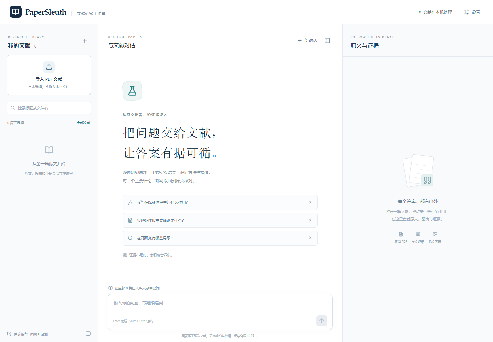
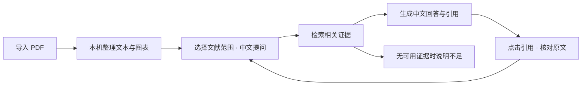

# PaperSleuth · AI 文献研究工作台

> 用中文提问，让 AI 回答带你回到原文证据。

**AI 产品设计作品 · 科研阅读场景 · 可运行 MVP**

PaperSleuth 围绕科研文献阅读中的一个核心任务设计：**从论文中找到与问题相关的结论，并核对它的出处与适用条件。** 用户导入 PDF 后，可以用中文提问、限定文献范围，并通过回答中的引用查看原文、图表和证据位置。

本项目的产品设计重点是：把文献检索、AI 回答和原文核对组织成一条连续的工作流程，目标是减少查找与核对信息时的操作切换。

| 产品概览 | 说明 |
|---|---|
| 目标用户 | 需要阅读英文实验论文的研究生、科研人员与学习者 |
| 核心任务 | 查找研究结论、追问实验条件、核对数据与出处 |
| 核心体验 | 中文提问 → 基于文献的回答 → 点击引用核对原文 |
| 当前阶段 | 本机可运行的 MVP；解析、检索和引用交互已有验证，真实论文生成回答仍需逐题验收 |



*当前前端截图，展示空文献库状态；使用受控的空库测试数据。*

## 01 · 产品问题：读完答案之后，仍然需要核对证据

阅读论文时，用户需要的不只有一段摘要，还包括实验做了什么、结果在什么条件下成立，以及原文如何支持这个结论。

| 阅读中的问题 | 对应的产品设计 |
|---|---|
| 用中文思考问题，却要在英文论文中定位术语和段落 | 支持中文提问，结合中英文检索与语义匹配寻找证据 |
| 找到结论后，还要在 PDF 中反复翻页核对 | 回答附带可点击引用，关联文献、页码和原文区域 |
| 数值脱离单位、实验条件或补充材料，容易产生误读 | 要求回答保留条件与单位；缺失的补充表格明确提示补充资料 |

以上是当前版本的**场景与用户假设**，尚未通过用户访谈或可用性研究验证。产品目标是减少寻找证据和切换页面的成本，实际效率提升仍需要用户任务测试。

## 02 · 核心场景：围绕一个研究问题逐步查证

以阅读一篇阿特拉津降解研究为例，用户可以沿着下面的路径工作：

1. **建立阅读范围**：导入主论文，查看处理进度；需要聚焦时，勾选当前要研究的文献。
2. **提出研究问题**：用中文询问“加入 Fe³⁺ 后，去除率和反应时间是多少？”
3. **检查回答出处**：点击引用，查看关联的英文片段、PDF 页码和高亮区域；图表证据可进入图表预览。
4. **继续追问条件**：追问“在自来水和河水中的效果分别如何？”再回到证据核对条件差异。
5. **识别资料缺口**：询问尚未导入的 Table S1 数据时，系统提示需要补充材料。

这是一条使用路径示例。当前已有检索与引用交互验证，示例中的真实模型回答还需要按验收基准核对。



## 03 · 关键设计：让用户保留范围、节奏与判断权

### 三栏工作台，把提问与核对放在同一处

| 区域 | 用户要完成的事 | 设计理由 |
|---|---|---|
| 左侧：我的文献 | 导入、查找、勾选文献，查看处理状态 | 让用户明确资料是否可用，以及本轮提问基于哪些文献 |
| 中间：与文献对话 | 提问、阅读回答、继续追问、停止生成 | 让研究问题成为操作主线 |
| 右侧：原文与证据 | 查看 PDF、解析文本、图表和清洗记录 | 把回答的依据放在可直接核对的位置 |

桌面端并列展示三个区域，方便对照；小屏幕通过展开与关闭证据面板切换阅读。证据面板也可以收起，为对话留出空间。

### 关键取舍，以及它们带来的体验

| 设计决策 | 为什么这样设计 | 需要接受的取舍 |
|---|---|---|
| 提问范围显式可见 | 默认使用全部已入库文献，也可限定到勾选文献；输入框上方持续显示范围 | 用户需要主动检查范围，选定文献也可能缺少所需证据 |
| 引用能回到文献位置 | 正文证据跳转到 PDF 页码与区域，图表证据关联对应预览 | 有引用只表示存在关联来源，仍需核对结论是否被原文支持 |
| 等待过程提供反馈 | 导入展示解析、模型加载、向量化进度；问答展示检索与生成阶段，并支持停止生成 | 首次加载模型耗时较长，需要管理等待预期 |
| 清洗过程可检查 | 保留原始 PDF 与清洗记录，保护数字、单位和正文公式 | 复杂版面与表格仍可能解析不准，需要人工复核 |
| 问答服务不可用时保留阅读能力 | 未配置密钥仍能导入、解析和查看文献；失败任务可重试 | AI 问答依赖服务配置与网络，尚有首次使用门槛 |
| 更新索引时保留已有证据 | 新索引成功后再切换，历史引用可读取对应旧版本 | 保留历史版本会增加本机存储占用 |

这些取舍共同服务于一个原则：**AI 帮用户定位与组织信息，用户能够查看依据、发现缺口，并决定如何使用结论。**

## 04 · AI 如何参与：检索、回答与信任边界

AI 承担两个主要环节：理解提问并形成检索问题，以及依据召回片段组织中文回答。文献处理与检索在本机完成，问答生成使用配置的 DeepSeek 服务。

| 环节 | 当前机制 | 对用户的意义 |
|---|---|---|
| 理解提问 | 结合对话上下文改写独立的中英文检索问题；改写失败时使用原问题继续检索 | 支持中文提问与连续追问 |
| 查找证据 | 语义检索与关键词检索融合，再对候选片段重排序 | 同时关注问题含义与化学式、缩写、图表编号等线索 |
| 组织回答 | 提示词要求只依据本轮证据，保留实验条件、单位与适用范围，并区分本篇结果与引用的其他研究 | 让回答更便于科研阅读和复核；这些要求仍需实际评测 |
| 检查引用 | 检查引用 ID 是否属于本轮提供的来源，标记无效引用或缺少引用的回答 | 暴露引用异常；校验不等于证明结论正确 |

### 把“资料不足”设计成可以继续操作的反馈

- **尚无可用文献索引**：提示先导入文献或等待处理完成。
- **未检索到证据**：明确说明当前文献没有足够证据回答。
- **缺少补充表格**：对于 Table S 编号表格，检查是否实际导入表格内容；只有正文提及时，提示导入对应补充材料。
- **问答服务失败**：显示密钥、限流、超时或连接问题，支持用户重试。

证据不足的提示有两层：没有召回片段、缺失 Table S 表格等情况由程序处理；已经召回片段但内容不足的情况，主要依靠模型遵守提示词，尚不能保证全面识别。

### 当前能力边界

- 图注参与检索，图片区域可查看；当前没有图像视觉推理，不能据曲线自动读取数值。
- 支持选择多篇文献作为范围；跨文献结论冲突的回答质量尚待专项验证。
- 复杂跨页表格、特殊版面与 OCR 结果仍需核对原文。
- 文献解析、索引和存储在本机完成；问题、相关对话上下文及检索片段会发送给配置的问答服务，完整 PDF 不发送给该服务。

## 05 · 产品验证：已证明什么，还需要证明什么

验证重点围绕实际任务展开：资料能否正确处理、相关证据能否找到、引用能否带用户回到原文。

以下结果来自 **2026-10-12 的既有验收记录**，详细环境、问题清单与待验证项见 [验收记录](docs/acceptance.md)。

| 验证对象 | 已有结果 | 结果的含义 |
|---|---|---|
| 真实论文导入 | 一篇 12 页论文完成解析与向量化，生成 56 个片段 | 验证该样本文献能够完成入库 |
| 中文问题检索 | 20/20 个问题至少命中一个预期证据页 | 衡量证据页命中情况，不能据此推导生成回答准确率 |
| 引用交互 | 受控回答配合真实召回坐标，验证文献切换、页码跳转和高亮 | 验证引用交互；受控回答不作为真实模型回答质量结果 |
| 资料缺失反馈 | 缺失 Table S1 时返回不足说明 | 验证具体的补充表格缺失场景 |
| 本机检索耗时 | 模型加载后，19 次检索与重排序约 0.28–0.44 秒 | 不包含云端改写和生成，也不代表其他文献或大批量性能 |
| 运行与异常处理 | 既有记录累计 15 项自动化测试通过；DeepSeek 连接、检索式改写和简短流式回答已验证 | 验证基础链路，真实论文生成回答仍需逐题验收 |

目前没有用户研究、使用规模、留存或阅读效率提升数据。当前展示的是可运行的产品原型与已有验证，不把设计目标写成用户收益实测。

## 06 · 下一轮验证：先确认用户能完成研究任务

| 优先级 | 要回答的产品问题 | 验证方式 |
|---|---|---|
| P0：回答可信度 | 主要结论、数值、单位和实验条件是否有对应证据？ | 按现有真实论文基准逐题人工核对，记录事实错误、遗漏条件和引用错配 |
| P1：任务完成 | 目标用户能否独立完成“导入 → 提问 → 找到并核对证据”？ | 用同一组阅读任务对比直接阅读 PDF 与使用工作台，记录完成率、耗时和操作障碍 |
| P2：边界处理 | 面对跨文献冲突、复杂表格与缺失材料，反馈是否准确且易懂？ | 扩充文献与反例，再观察用户是否能理解提示并采取下一步操作 |

这些是下一轮验证计划，尚未开展。优先依据任务测试结果改进引导、证据呈现与异常反馈。

## 07 · 体验与文档

运行环境为 Windows 本机。首次安装、问答连接配置、磁盘空间、参数调整和排障见 [安装、运行与开发指南](docs/development.md)。

完成安装与配置后，在项目目录的 PowerShell 中启动：

```powershell
.\start.ps1
```

浏览器访问 [本机工作台](http://127.0.0.1:8000)。未配置问答密钥时仍可体验文献导入与原文查看。

- [安装、运行与开发指南](docs/development.md)：安装步骤、配置、排障与开发命令。
- [验收记录](docs/acceptance.md)：真实样本、检索基准、已有结果与待验证项目。
